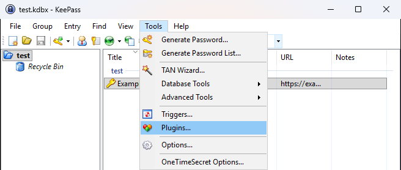
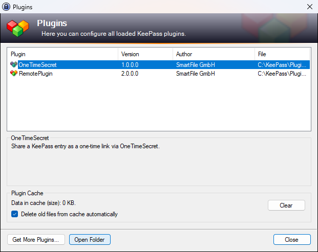
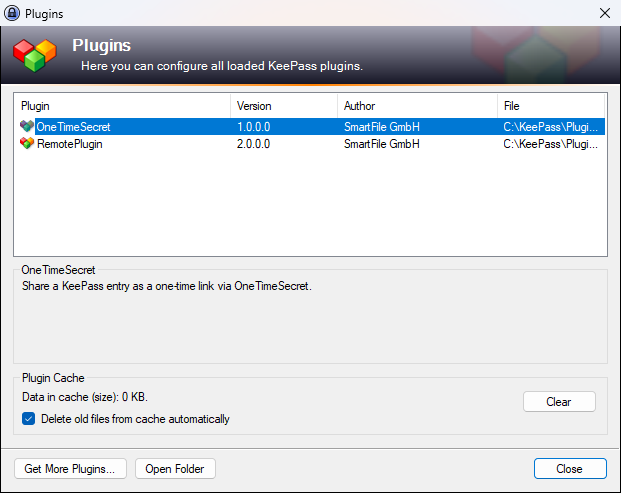
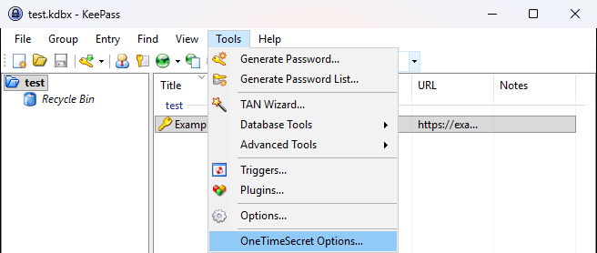
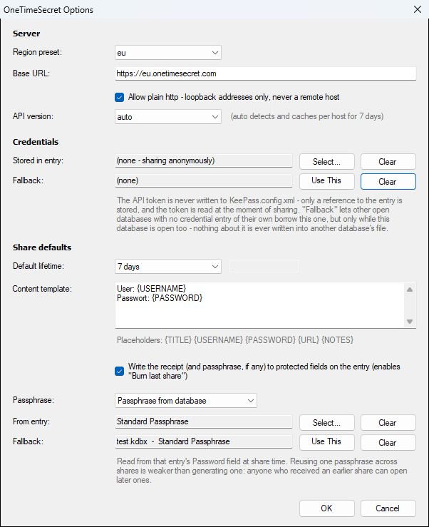
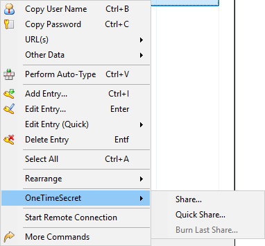
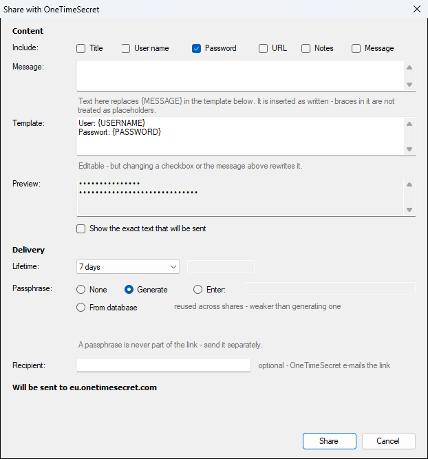
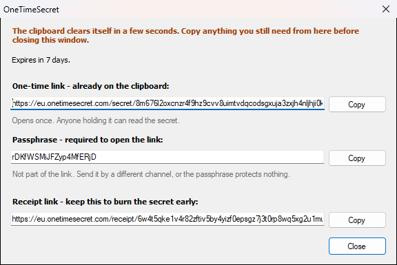
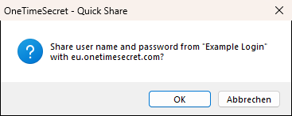
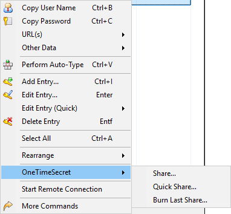

# OneTimeSecret for KeePass — User Guide

*[Diese Anleitung auf Deutsch](USER_GUIDE.de.md)*

This guide is for anyone who uses KeePass to store passwords but doesn't want to deal
with technical jargon. It walks through installing the plugin, setting it up, and using
it to send a password to someone else safely — step by step, with nothing assumed.

If a word might be unfamiliar, it's explained the first time it comes up.

> Looking for the technical reference instead? See `README.md`.

---

## What this plugin actually does

Normally, if you need to send someone a password, you might text it, email it, or read
it out loud — all of which leave a permanent copy sitting in that chat history or inbox
forever, for anyone who later gets access to it.

This plugin instead creates a **one-time link**: a web address that shows the password
exactly once. The moment the other person opens it and views the password, the link
stops working — even for you. If no one ever opens it, it still expires automatically
after a time limit you choose (for example, one day). Either way, nothing is sitting
around waiting to be found later.

It does this by sending the password to a service called **OneTimeSecret**
(onetimesecret.com) and getting back that one-time link, which you then send to the
other person however you like (chat, email, whatever) — it's just a link, not the
password itself, so it's safe to send through normal channels.

---

## Part 1 — Installing the plugin

**What you need first:** KeePass 2.x already installed on your computer, and a working
internet connection to download the plugin.

1. Go to the
   [releases page](https://github.com/ML-SmartFile/keepass-onetimesecret/releases/latest)
   and download the file named `OneTimeSecret.dll`.

2. Open KeePass.

3. In the menu bar at the top, click **Tools**, then **Plugins**.

   

4. In the Plugins window that opens, click the **Open Folder** button (it opens the
   folder where KeePass keeps its plugins). This opens a normal Windows folder window.

   

5. Copy the `OneTimeSecret.dll` file you downloaded in step 1 into that folder (drag it
   in, or copy-and-paste it like any other file).

6. Close KeePass completely, then open it again. (Plugins are only loaded when KeePass
   starts up, so simply closing the Plugins window isn't enough.)

7. To check it worked: open **Tools → Plugins** again. You should now see
   "OneTimeSecret" listed with a version number.

   

If you don't see it listed, double check you copied the file into the right folder in
step 5, and that you fully restarted KeePass (not just minimized it).

---

## Part 2 — Setting it up (optional, but worth doing)

You can skip this whole part and still use the plugin — it will share passwords
**anonymously**, which works fine and requires nothing from you. This part is only for
two optional extras: using your own OneTimeSecret account (if you have one), and
changing the defaults (like how long a shared link should last before it expires).

1. In KeePass, click **Tools**, then **OneTimeSecret Options…**

   

2. You'll see a settings window with a few sections:

   - **Server** — leave this alone unless someone (e.g. your IT department) has told you
     to use a specific server address. The default works for most people.
   - **Credentials** — this is where you can connect your own OneTimeSecret account, if
     you have one. This is entirely optional:
     - If you leave it empty, shares are sent anonymously — this works fine for everyday
       use.
     - If you do have an OneTimeSecret account and want to use it: in KeePass, create or
       pick an entry that holds your OneTimeSecret account email (as the "user name")
       and your OneTimeSecret API token (as the "password" — this is a special code from
       your OneTimeSecret account settings, not your actual login password). Then come
       back here and pick that entry. Your email and token stay inside your KeePass
       database at all times — the plugin only looks at them at the exact moment you
       share something.
   - **Share defaults** — the settings used unless you change them for a specific share:
     - **Default lifetime** — how long a shared link stays valid before it automatically
       expires, if no one has opened it yet (e.g. "1 day").
     - **What gets included** — which pieces of information from a password entry
       (its title, user name, password, website address, notes) get put into the share
       by default. Password is included by default; the rest you can turn on or off.
     - **Passphrase** — see the explanation in Part 3 below. You can set the default
       behavior here.

   

3. Click **OK** to save your settings and close the window.

---

## Part 3 — Sharing a password

1. In KeePass, find the entry (the saved password) you want to share, and **right-click**
   on it.

2. In the right-click menu, hover over **OneTimeSecret**. A small side menu appears with
   a few options — the two you'll use are **Share…** and **Quick Share…**

   

### Option A: "Share…" — when you want to double check everything first

1. Click **Share…**. A window opens showing exactly what's about to be sent — by
   default, the user name and password from that entry.

2. **Checkboxes** at the top let you add or remove what's included (e.g. also include
   the website address, or leave out the user name). A preview box shows you the exact
   text that will be sent — it's blurred out by default; click "show" if you want to
   read it before sending.

3. **How long it lasts** — a dropdown lets you pick how long the link should remain
   valid (e.g. 1 hour, 1 day, 7 days) before it expires on its own, even if unopened.

4. **Passphrase** — this is an *extra* password that the other person has to enter
   before they can see the shared password. Think of it as a second lock on top of the
   link itself. Your options:
   - **None** — anyone with the link can open it, no extra password needed.
   - **Generate one** — the plugin creates a random passphrase for you, which you'll see
     after sending. You'd then tell the other person this passphrase separately from the
     link itself (e.g. send the link by email, and read them the passphrase over the
     phone) — that way, someone who only intercepts one of the two still can't get in.
   - **Enter one each time** — you type in your own passphrase to use for this specific
     share.

5. (Optional) **Recipient email** — if you fill this in, OneTimeSecret will also email
   the link directly to that address for you.

6. A line near the bottom tells you exactly which server the information will be sent
   to, so you always know where it's going.

7. Click the **Share** button. A short progress indicator appears while it sends — this
   usually takes a couple of seconds. (A **Cancel** button is available while it's
   working, which becomes **Close** once the information has actually been sent — at
   that point, cancelling can't "unsend" it, since it may already be stored.)

   

8. Once it's done, a result window shows you:
   - The **link** to send to the other person, with its own **Copy** button.
   - If you chose to generate or enter a passphrase, that's shown too, with a
     **separate Copy button** — on purpose, so copying one doesn't overwrite the other
     on your clipboard.
   - A **receipt link**, with its own Copy button — this is not for the other person;
     it's what lets you revoke the share early later (see Part 4).

   

   > This window also tells you the clipboard clears itself in a few seconds — copy
   > whatever you need from it before closing the window.

9. Send the link (and passphrase, if there is one) to the other person however you
   normally would — chat, email, text message. Remember: if you used a passphrase, send
   it through a *different* channel than the link, so no single intercepted message
   reveals both.

> **About your clipboard:** when you click "Copy," KeePass automatically clears
> whatever you copied after a short countdown (its normal behaviour for anything you
> copy from it, not specific to this plugin). If you need more time, paste it somewhere
> immediately rather than waiting.

### Option B: "Quick Share…" — when you just want to send it, fast

1. Click **Quick Share…** instead of Share.

2. A single confirmation box appears, stating exactly what's about to be sent (e.g. "Share
   user name and password from 'Example Login' with eu.onetimesecret.com?"). Click **OK**
   to confirm, or **Cancel** to back out.

   

3. It sends using whatever defaults you set up in Part 2 (or the built-in defaults if you
   skipped that part) — no other window to fill in.

4. The same result window from Option A appears afterward with your link (and passphrase,
   if one was generated).

Quick Share is just a faster version of Share — it always still asks you to confirm once
before sending anything, and always still shows you the result window afterward so you
don't lose the link or passphrase.

---

## Part 4 — Taking back a share early ("burning" it)

If you've sent a link but change your mind — you want it to stop working *before*
someone opens it or before it would normally expire — you can revoke it, as long as you
turned on the receipt option (see below).

**For this to work, "Write the receipt back to the entry" must have been turned on**
(Part 2, Share defaults) at the time you shared it. If it was, a small reference gets
saved on that same password entry, which is what lets you burn it later.

1. Right-click the entry you shared earlier.

2. In the **OneTimeSecret** submenu, you'll now see **Burn Last Share…** underneath
   Share and Quick Share (it only appears if that entry has an active share to revoke).

   

3. Click it, confirm in the box that appears, and the link is deactivated — if anyone
   tries to open it after this, they'll see it's no longer available.

---

## Good to know

- **Nothing is sent anywhere except the one server you configured.** The plugin doesn't
  phone home, track usage, or talk to any other address.
- **If you didn't connect an account in Part 2**, every share goes out anonymously —
  that's completely normal and works the same way.
- **A plain `http://` address is always refused** for safety, unless you're specifically
  testing against something running on your own computer. You won't run into this in
  normal use.
- If something goes wrong when sharing (no internet connection, wrong account details,
  etc.), the plugin shows you a plain description of what happened rather than a cryptic
  error code.

---

## Still stuck?

If a step above doesn't match what you're seeing, or something isn't working, check the
*Security* and *Configuring it* sections of `README.md` for more technical detail, or
reach out to whoever set this up for you.
